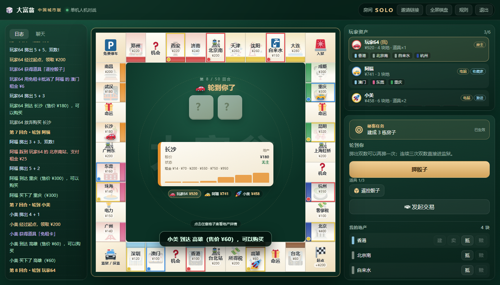
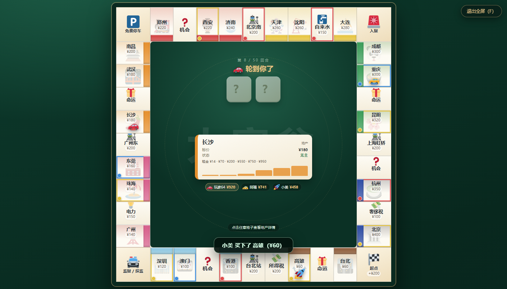
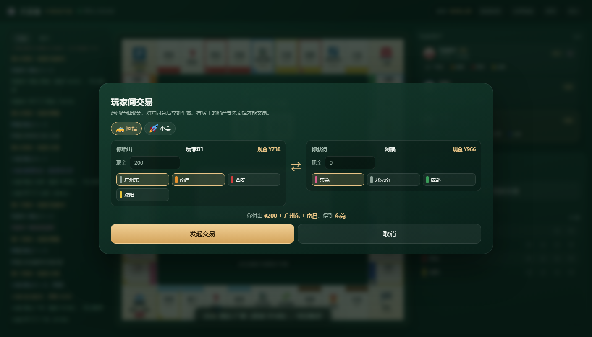

# 大富翁 · 中国城市版

一个能 2–6 人实时联机的经典大富翁网页游戏：40 格中国城市棋盘、买地盖房、机会命运、抵押贷款、监狱、破产淘汰，50 回合按净资产结算。

**在线试玩：<https://gongyukai.github.io/dafuweng/>**（GitHub Pages，WebRTC 房主模式）

**零第三方依赖**（纯 Node + 原生前端），既可以在自己电脑上跑服务器，也能直接丢到 GitHub Pages 上用 WebRTC 联机。



全屏棋盘模式（右上角按钮或按 F）：



玩家间交易：



## 功能

- 2–6 人房间，4 位房间码，房主开局
- 20 / 35 / 50 回合三档，房主开局前可选
- 秘密任务（默认关闭，建房时可开）：每人一张隐藏目标（集齐同色 / 现金 ¥2200 / 8 块地 / 3 栋房 / 3 个车站），达成后结算净资产 +20%，不提前结束对局
- 道具卡：遥控骰子、免租卡、拆迁卡、均富卡，经过起点或抽卡获得，手牌上限 3
- 全场事件：每 5 回合触发（经济繁荣、旅游旺季、台风、慈善晚宴、税务稽查）
- 电脑性格：激进 / 稳健 / 收藏家 / 捣蛋，面板上有标签
- 玩家间交易：选地产 + 现金，对方接受后立即生效（有房子的地要先卖掉）；电脑玩家会按价值判断接受或拒绝
- 行动字幕：每个玩家的掷骰、买地、抽卡、付租、交易都会在棋盘上放大渐隐显示
- 每座城市有专属地标底纹 + 分组色卡渐变，纸纹质感棋盘
- 12 种可选棋子（Twemoji 开源素材），开局前自己挑，走格子有逐格动画
- 玩家资产面板：每个人的地产实时列在名字下面，点一下就在棋盘中央看详情
- 全屏棋盘模式（右上角按钮或按 F 键），格子更大
- 掷骰、双数再掷、连续三次双数入狱、经过起点领 ¥200
- 买地、同色垄断租金翻倍、4 栋房子 + 旅馆、均衡建造/出售
- 抵押地产换现金、赎回，破产时自动变卖资产
- 机会 / 命运各 15 张卡，覆盖移动、罚款、出狱卡、修房、生日收钱等
- 监狱三种出路：掷双数、付 ¥50 保释、出狱卡；三次失败强制保释
- 电脑玩家（规则 AI，不是大模型），1.5 秒一步，看得清它在干什么
- 操作日志 + 聊天 + 掉线重连 + 加入防连点 + 超时自动跳过 + 手机竖屏适配
- 50 回合上限，防止游戏无限拖长，到点按净资产判胜
- 动画：骰子摇动、棋子跳跃移动、租金飘字、卡片翻入、落点高亮

## 快速开始

需要 Node.js 18+。本项目已经带好 Node，也可以自己装。

```powershell
cd D:\deepseek\monopoly
node server.mjs
```

然后浏览器打开 <http://localhost:3210>。

- **同一台电脑试玩**：多开几个浏览器标签页即可（每个标签页是独立玩家）
- **同一 WiFi 的朋友**：启动日志里会打印 `http://192.168.x.x:3210`，把这个地址发给他们
- 第一次局域网访问会被 Windows 防火墙拦，按提示允许即可；或用管理员 PowerShell 放行：

```powershell
netsh advfirewall firewall add rule name="大富翁 3210" dir=in action=allow protocol=TCP localport=3210
```

换端口：`$env:PORT=8080; node server.mjs`

## 三种联机方式

| 方式 | 怎么用 | 稳定性 | 适合 |
|---|---|---|---|
| 本机 / 局域网服务器 | `node server.mjs`，朋友连内网 IP | 最稳，服务端权威、防作弊 | 家里、公司、宿舍 |
| 公网隧道 | 服务器 + `cloudflared`，拿到一个临时公网地址 | 稳，但地址每次重启会变 | 异地朋友临时开一局 |
| GitHub Pages（WebRTC） | 纯静态页面，谁建房谁当主机 | 看网络，房主关页面房间就没了 | 不想开服务器、想直接发链接 |

游戏会自动检测：能访问到 `/api/health` 就用服务器模式，否则自动切到 WebRTC 房主模式。

## 部署到 GitHub Pages

Pages 只能托管静态文件，所以联机走 **WebRTC 房主模式**：创建房间的那个人的浏览器就是主机，其他玩家点对点连过去。

**方式一：GitHub Actions（推荐，推送即更新）**

1. 新建仓库，把本项目推上去（`public/`、`server.mjs` 等全部文件）
2. 仓库 **Settings → Pages → Build and deployment → Source** 选 **GitHub Actions**
3. 推送到 `main` 后，`.github/workflows/pages.yml` 会自动把 `public/` 发布出去
4. 地址形如 `https://你的用户名.github.io/仓库名/`

**方式二：分支 /docs 目录**

```powershell
cd D:\deepseek\monopoly
node scripts/make-pages.mjs   # 生成 docs/
git add docs && git commit -m "build pages" && git push
```

然后在 **Settings → Pages → Source** 选 **Deploy from a branch → main → /docs**。

部署完把页面链接发给朋友，他们打开后输入房间码（或直接点你复制的邀请链接）就能加入。

**当前仓库已经部署好**：<https://gongyukai.github.io/dafuweng/>（仓库 `gongyukai/dafuweng`，public）。

如果 `github.com:443` 连不上（国内常见），`git push` 会失败，可以改用 API 推送：

```powershell
$env:GH_TOKEN = "<你的 GitHub token>"
node scripts/api-push.mjs gongyukai dafuweng "更新说明"
```

等 `github.com` 恢复后，再 `git fetch origin && git reset --hard origin/main` 把本地历史对齐。

### Pages 模式的限制（说清楚，免得踩坑）

- **房主必须保持页面打开**，关掉浏览器房间就解散了
- 联机信令走 [PeerJS 公共服务器](https://peerjs.com/)，个别网络环境可能连不上；被拦的话就用自己电脑跑 Node 服务
- 公司/校园网常禁用 WebRTC，这种网络下 P2P 连不上是正常的
- 页面是 https，不能用 `ws://` 的自建信令，需要 `wss://`

## 公网联机（Cloudflare Tunnel）

不想把服务器暴露到公网，也不想开路由器端口，用临时隧道最省事：

```powershell
winget install Cloudflare.cloudflared
cloudflared tunnel --url http://localhost:3210
```

它会输出一个 `https://xxxx.trycloudflare.com` 地址，直接发给朋友。关掉命令窗口地址就失效，每次重启会变。

长期使用就该用固定域名的命名隧道，或者把 Node 服务部署到 VPS / Render / Railway。

## 玩法

- **目标**：让其他人破产；撑到第 50 回合结束时，净资产最高的人获胜
- **移动**：两枚骰子，经过或停在起点领 ¥200；双数可再掷一次，连续三次双数直接入狱
- **买地**：停在无主地产可按标价买下；别人踩到要付租金；同色地块集齐后基础租金翻倍
- **盖房**：必须集齐同色且该组没有抵押；同一组必须均衡建造，第 5 栋是旅馆
- **缺钱**：卖房收回一半造价、抵押地产拿一半地价；还债不够会自动变卖，仍然不够就破产
- **监狱**：掷出双数、付 ¥50、或用出狱卡；三次没掷出双数会被强制收 ¥50 并移动
- **破产**：现金和地产按规则转给债主（或收归银行），最后剩下的人获胜
- **交易**：右侧「发起交易」可以拿地产和现金跟任何人换；对方在操作区点接受即成交，交易窗口会实时汇总双方得失
- **秘密任务**（房主可在建房时开启，默认关闭）：开局每人一张，只有自己可见；达成后不立即结束，最终结算时净资产 +20%，结束时公开所有人任务
- **道具**：经过起点或抽到道具卡会得到；遥控骰子指定点数、免租卡自动抵消一次租金、拆迁卡拆对手一栋房、均富卡把所有人现金拉平
- **事件**：每 5 回合一次全场事件，租金翻倍、台风拆房、慈善均贫富、税务稽查都可能在列表里出现

## 目录结构

```
monopoly/
├─ server.mjs                 Node 服务：静态托管 + REST + SSE + 机器人驱动
├─ public/                    纯静态站点（可直接发 Pages）
│  ├─ index.html
│  ├─ style.css
│  ├─ assets/twemoji/         棋子与图标（Twemoji，CC-BY 4.0）
│  ├─ game/                   同构规则引擎（服务端和浏览器共用）
│  │  ├─ board.js             40 格棋盘数据
│  │  ├─ cards.js             机会 / 命运卡
│  │  └─ engine.js            回合状态机、租金、抵押、破产、机器人
│  └─ js/
│     ├─ net.js               HttpNet / HostNet / GuestNet / LocalNet
│     └─ app.js               棋盘渲染与交互
├─ scripts/make-pages.mjs     生成 docs/（Pages 分支发布用）
├─ test/
│  ├─ sim.mjs                 100 局全 AI 对局压测
│  ├─ e2e.mjs                 服务端建房/加入/SSE 全链路
│  ├─ ui.mjs                  CDP 驱动真实浏览器点按钮
│  └─ p2p.mjs                 双浏览器 WebRTC 房主模式测试
└─ .github/workflows/pages.yml
```

## 测试

```powershell
node test/rules.mjs       # 规则单测：掷骰、买地、均衡建造、抵押、破产转移等 40 项断言
node test/features.mjs    # 新玩法：回合设置、任务开关、秘密任务结算加成、4 种道具、全场事件、电脑性格，42 项断言
node test/trade.mjs       # 交易单测：发起/接受/拒绝/取消/非法内容/过期，27 项断言
node test/sim.mjs 100     # 规则引擎：100 局机器人互打，检查不崩、能分出胜负
node test/e2e.mjs         # 需要先 node server.mjs，验证建房/加入/SSE/重连
node test/tokens.mjs      # 棋子定位：普通移动与入狱传送后必须落在正确格子（需要 ?dev=1）
node test/ui.mjs          # CDP 驱动真实浏览器：选棋子、开局、掷骰、动画、聊天、规则弹窗
node test/multi.mjs       # 6 人 HTTP 联机：满员、权限、三方同步、聊天、交易、重连（需要服务端）
node test/multi-ui.mjs    # 双浏览器界面联机：建房→加入→开局→发起交易→接受→现金同步
node test/p2p.mjs         # 双浏览器 WebRTC 房主模式
node test/p2p3.mjs        # 公网三人 P2P：两人观战同步、访客刷新重连
```

`ui.mjs` / `p2p.mjs` 需要一个开了远程调试的 Edge：

```powershell
msedge --headless=new --remote-debugging-port=9222 --user-data-dir="$env:TEMP\edge-test" "http://127.0.0.1:3210/?solo=1"
node test/ui.mjs
```

## 常见问题

**朋友进不来（服务器模式）**
先确认他用的是你的内网 IP 而不是 `localhost`；再看 Windows 防火墙有没有放行 3210；手机和电脑要在同一个 WiFi。

**提示「找不到这个房间」（Pages 模式）**
房主可能已经关了页面，或者房间码打错了。P2P 模式没有常驻服务器，房主一关就没了。

**一直卡在「正在连接房主」**
多半是网络挡了 WebRTC（公司网、校园网、部分移动网络）。换热点试试，或者改用 Node 服务器 + 隧道。

**页面提示无法加载 WebRTC 组件**
PeerJS 的 CDN 被拦了。可以自己托管 `peerjs.min.js`，或改用服务器模式。

**端口被占用**
`$env:PORT=3210` 换一个，或者 `Get-NetTCPConnection -LocalPort 3210` 看看是谁占了。

**两台设备会互相顶号吗？**
不会。会话存在 sessionStorage 里，同一个浏览器开多个标签页也是各自独立的玩家。

## 后续可以加

- 玩家间交易（换地、补差价）——最能提升翻盘乐趣
- 不买就拍卖，减少「都不买导致僵局」
- 道具 / 点券系统（大富翁 4 风格）
- 皮肤与主题（沿海城市、世界城市、校园版）
- 账号、战绩、排行榜、对局存档
- 音效（WebAudio 合成，不依赖外部文件）

## 说明

棋盘地名、数值参考经典 Monopoly 公开规则整理；界面与代码为自制，不包含任何 Hasbro 官方素材。

美术素材：
- 棋子与地标：Twemoji（[CC-BY 4.0](https://github.com/jdecked/twemoji)），已本地打包
- 界面图标：Font Awesome Free（[CC BY 4.0](https://fontawesome.com/license/free)），已本地打包
